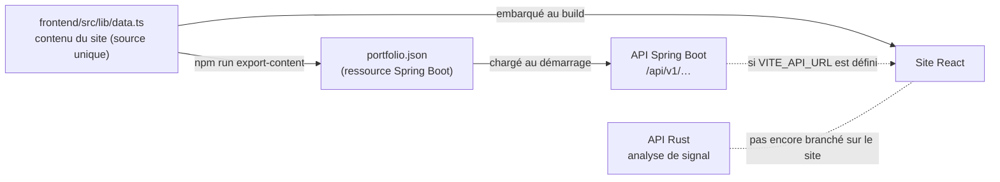

# Portfolio — Lucas Desmartin

Élève-ingénieur biomédical à l'ESME (majeure Biotech & Numérique), à la recherche d'un **stage de fin d'études de 6 mois à partir du 7 avril 2027**, en R&D biomédicale et en IA appliquée aux données de santé.

[LinkedIn](https://www.linkedin.com/in/lucas-desmartin-953177250/)

Ce dépôt contient le site et ses deux services backend. Le site présente mes projets (deep learning sur CT-scans, pipeline d'analyse d'ADN Nanopore à l'INSERM, régulation de glycémie, prototypes embarqués) et sert aussi de projet full-stack démontrable.

## Architecture



| Dossier | Rôle | Stack |
|---|---|---|
| [`frontend/`](frontend) | Le site | React 19, TypeScript, Vite, Tailwind CSS 4, motion, Three.js / React Three Fiber, TanStack Query |
| [`backend-java/`](backend-java) | API du contenu et des messages de contact | Java 21, Spring Boot 3.5, Spring Data JPA, H2 (dev) / PostgreSQL (prod) |
| [`backend-rust/`](backend-rust) | Statistiques temporelles et spectrales d'un signal (RMS, FFT) | Rust, Axum, Tokio, rustfft |

### Une seule source de contenu

Tout le contenu (projets, parcours, stages) est écrit dans `frontend/src/lib/data.ts`. Le script `npm run export-content` le convertit en `backend-java/src/main/resources/content/portfolio.json`, que l'API recharge à chaque démarrage.

La lecture est stricte : un champ ajouté dans `data.ts` mais inconnu des entités Java fait échouer le démarrage et les tests, plutôt que de disparaître en silence.

Le site embarque le même contenu : il reste entièrement utilisable sans backend. Quand `VITE_API_URL` est défini, il affiche d'abord le contenu local puis le confirme auprès de l'API.

## Lancer en local

```bash
# Site — http://localhost:5173
cd frontend
npm install
npm run dev

# API de contenu — http://localhost:8081 (JDK 21)
cd backend-java
mvn spring-boot:run

# API d'analyse de signal — http://localhost:8082
cd backend-rust
cargo run --release
```

Sous Windows, `backend-rust/.cargo/config.toml` utilise la chaîne GNU (MSYS2 / MinGW).

Après une modification de `data.ts` :

```bash
cd frontend
npm run export-content
```

## Tests et vérifications

```bash
cd backend-java && mvn test      # 8 tests : ordre et contenu servis, 404, validation et intégrité du contact
cd backend-rust && cargo test    # 4 tests : fréquence d'un sinus, dérive basse fréquence, entrées invalides
cd frontend && npx tsc -b && npx eslint . && npm run export-content -- --check
```

## API

| Méthode | Route | Description |
|---|---|---|
| `GET` | `/api/v1/projects` | Projets, dans l'ordre du site |
| `GET` | `/api/v1/projects/{slug}` | Détail d'un projet : chaîne de mesure, sections, tableaux de résultats, figures |
| `GET` | `/api/v1/parcours` | Étapes du parcours |
| `GET` | `/api/v1/stages` · `/api/v1/stages/{slug}` | Stages |
| `POST` | `/api/v1/contact` | Message de contact (nom, email, message), validé |
| `GET` | `/health` (Rust) | État du service |
| `POST` | `/api/signal/stats` (Rust) | `{ samples, sampling_rate }` → moyenne, écart-type, RMS, min, max, fréquence dominante, énergie 0–5 Hz |

En production, l'API Java lit `SPRING_PROFILES_ACTIVE=prod`, `DATABASE_URL`, `DATABASE_USERNAME`, `DATABASE_PASSWORD` et `CORS_ALLOWED_ORIGINS`. Les deux services écoutent sur `PORT` s'il est défini.
